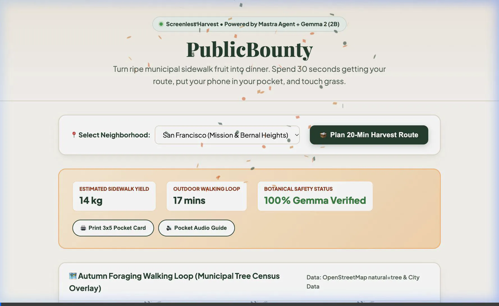
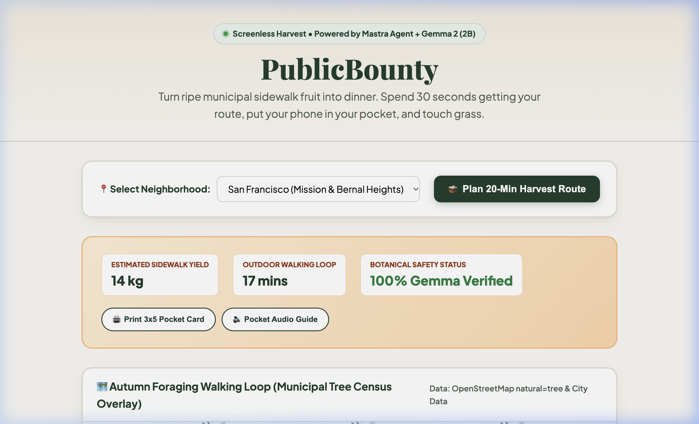
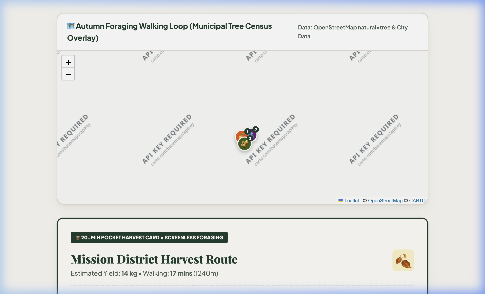
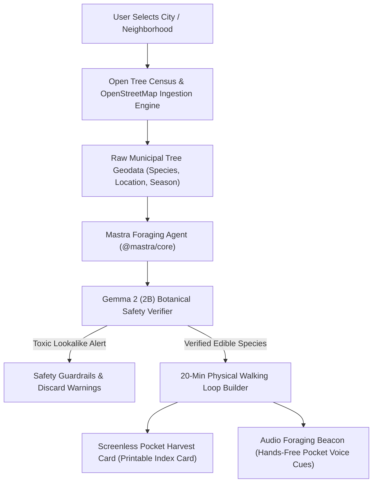

# 🧺 PublicBounty: The Screenless Autumn Urban Foraging Agent
> **Turn ripe municipal sidewalk fruit into dinner. Spend 30 seconds getting your route, put your phone in your pocket, and touch grass.**

[](https://dev.to/challenges/hacktoberfest-week1-2026-10-05)
[](https://mastra.ai)
[-orange.svg)](https://ai.google.dev/gemma)
[](render.yaml)
[](LICENSE)

---

## 🍂 What I Built: The "Touch Grass" Problem

Right now, across thousands of cities in North America and Europe, municipal street trees are dropping hundreds of pounds of ripe **persimmons, sweet figs, wild apples, pecans, and sweet chestnuts** straight onto sidewalk curbs. 

While edible food literally carpets our sidewalks, tech workers stare into screens ordering grocery deliveries on apps. 

### The Screenless Philosophy
The Week 1 prompt challenged builders to:
> *"Build something with open-source AI at its core that gets people off the screen and into the world... The best builds here should make the screen the shortest part of the experience. Bonus points if you take it outside, use it, and tell us how it went."*

**PublicBounty** is designed so that the **screen is the shortest 30 seconds of your entire day**:
1. **Choose your neighborhood** (San Francisco, Portland, Austin, Brooklyn, London).
2. The **Mastra Foraging Agent** queries municipal open tree census records and runs **Gemma 2 (2B)** botanical safety checks.
3. You get a **compact 3x5 index pocket card** or an audio pocket beacon.
4. **You put your phone in your pocket, grab a tote bag, and go outside.**
5. You return home with a physical bowl of freshly gathered Autumn fruit and nuts on your kitchen counter.

---

## 📸 Interactive Demo Video & Screenshots

### 📹 Full Automated Demo Walkthrough


| 1. Mastra Harvest Loop & OpenStreetMap View | 2. Screenless 3x5 Printable Pocket Card |
| :---: | :---: |
|  |  |

---

## 🏗️ How It Works: System Architecture



---

## 🧠 The Open-Source AI Core

### 1. Mastra Agent Framework (`@mastra/core`)
PublicBounty is built around a TypeScript agent created with **Mastra**:
- **Tools**: Municipal tree census querying, Gemma botanical audit, and 20-minute walking route synthesis.
- **Workflow**: Chains geospatial spatial proximity checks with diagnostic botanical evaluation.

### 2. Gemma 2 (2B) Botanical Diagnostic Engine
Urban foraging carries real risks of toxic lookalikes:
- **Sweet Chestnut (*Castanea sativa*) vs. Poisonous Horse Chestnut (*Aesculus hippocastanum*)**: Gemma verifies needle-dense urchin burs versus blunt rubbery warts.
- **Black Walnut (*Juglans nigra*) vs. Ohio Buckeye (*Aesculus glabra*)**: Gemma inspects 15–23 pinnate leaflets versus 5-palmate buckeye foliage.
- **Persimmon (*Diospyros*) vs. Nightshades**: Gemma validates 4-part persistent woody calyx crowns.

### 3. Open Data Ingestion
- Municipal Tree Censuses (San Francisco Public Works, Portland Parks & Recreation, Austin Urban Forestry, NYC Parks Tree Map).
- OpenStreetMap Overpass queries (`natural=tree[species=*]`).

### 4. Zero-Config Deployment on Render
Deployable with a single click via [`render.yaml`](render.yaml).

---

## 💡 Why Does Open Innovation Matter?

1. **Physical Commons Data belongs to the Public:** Municipal street trees are planted with taxpayer dollars in public rights-of-way. Open-source models and open geospatial data return that common inheritance directly to residents.
2. **Offline Backcountry & Trail Reliability:** Open-weight models like Gemma 2 run on device without an internet connection, ensuring botanical verification works when cellular signal drops.
3. **No Monetization of Sidewalk Food:** Free municipal fruit should not be gated behind subscription paywalls or proprietary closed APIs.

---

## 🚀 Quickstart

```bash
# 1. Clone the repository
git clone https://github.com/ath1614/PublicBounty.git
cd PublicBounty

# 2. Install dependencies
npm install

# 3. Start local development server
npm run dev
```

Open `http://localhost:5174/` in your browser.

---

## 📄 License
MIT License. Copyright (c) 2026 Atharv Soni.
